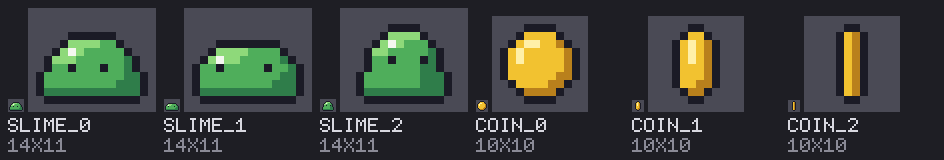
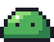
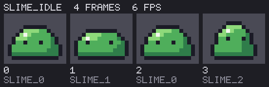
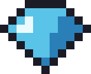

# pixelrows

Pixel art as rows of text. A sprite is a list of strings, one character per pixel, read against a palette:

```json
"coin_0": {
  "rows": [
    "...oooo...",
    "..oyyyyo..",
    ".oyhhyyYo.",
    "oyhyyyyyYo",
    "oyhyyyyyYo",
    "oyyyyyyyYo",
    "oyyyyyyYYo",
    ".oyyyyYYo.",
    "..oYYYYo..",
    "...oooo..."
  ]
}
```

pixelrows reads files of such sprites, checks them for common drawing mistakes, and renders them to PNG and to animated GIF. It can also draw them in code. It runs on Python 3.10 or newer and uses the standard library only.

Since the art is text, it can be written by hand, by a script or by a language model, and a change to it shows up in a diff.



 

## Running it

From a clone of this repo, with nothing installed:

```
python -m pixelrows sheet examples/critters.json --scale 1,8 --out out/sheet.png
```

`pip install .` in the clone adds a `pixelrows` command that does the same from any folder.

## The set file

Sprites live in a set file: JSON with a palette, the sprites, and the animation clips made of them.

```json
{
  "palette": { "o": "#1b1b26", "g": "#4fae5b" },
  "sprites": {
    "blob_0": { "rows": ["..oo..", ".oggo.", "oggggo", "oooooo"] },
    "blob_1": { "rows": ["......", ".oooo.", "oggggo", "oooooo"], "palette": { "g": "#8ed97a" } }
  },
  "anims": {
    "blob_idle": { "frames": ["blob_0", "blob_1"], "fps": 3 }
  }
}
```

- A palette key is one character. Its value is a colour as `#rrggbb`.
- `.` is transparent in every palette and cannot be given a colour.
- Every row of a sprite has the same length.
- A sprite may have a `palette` of its own. Its entries are laid over the set's for that sprite only.
- An anim is a list of sprite names in play order and a speed in frames per second. A name may appear more than once.

Saved with two spaces of indent, each row sits on its own line, so the rows read as the picture.

## Commands

Every command prints one JSON document, so a script can read the result.

| Command | What it does |
|---|---|
| `info FILE [NAME ...]` | Sizes, painted pixel counts and the colours each sprite uses, and anything wrong with the file |
| `check FILE` | What is wrong with the file and what the drawing rules find. The exit code is 1 when there is anything to report |
| `render FILE NAME --out PATH` | One sprite as a PNG |
| `sheet FILE [NAME ...] --out PATH` | Sprites side by side on one labelled page |
| `anim FILE NAME --out DIR` | A clip as `NAME.gif` at its real speed, and as `NAME_strip.png` with its frames side by side |
| `ramp --hue H --chroma C` | A colour ramp from dark to light |

`--scale N` sets how many pixels each cell becomes (8 unless given). `sheet` takes several scales, as in `--scale 1,8`, and draws every sprite once at each. `--background '#rrggbb'` sets what is behind the sprite. `python -m pixelrows COMMAND -h` lists everything a command takes.

```
python -m pixelrows info examples/critters.json coin_2
python -m pixelrows render examples/critters.json slime_0 --scale 12 --out out/slime.png
python -m pixelrows anim examples/critters.json slime_idle --out out
```



## Checks

`check` looks for mistakes that are easy to make in a grid of letters and hard to see there.

| Rule | What it finds |
|---|---|
| `lone_pixel` | A pixel with no neighbour of its own colour. `--allow-lone ow` lets the listed characters through, for eyes and glints |
| `colour_count` | More colours than a sprite of that size carries: one for every six painted pixels and never fewer than three, or the number given with `--max-colours` |
| `outline_gap` | An edge pixel that is not the outline colour. It runs when the outline character is named, as in `--outline o` |
| `frame_pixels` | A frame that paints far more or far fewer pixels than the rest of its clip |
| `feet_drift` | A clip whose lowest painted row moves by more than a pixel |

```
python -m pixelrows check examples/critters.json --outline o --allow-lone ow
```

A finding names the sprite or the clip and, where it is about pixels, lists them as `[x, y]`. Some findings are meant: the example coin loses half its pixels as it turns edge-on, and `check` reports that.

## Drawing in code

A `Canvas` is a grid to paint on that becomes a sprite. This is the gem in `examples/gem.py`: half of it is painted, the other half is mirrored from it, one side is shaded and the outline is added by rule.

```python
from pixelrows import Canvas

canvas = Canvas(9, 7)
canvas.rect(2, 0, 3, 1, "c")
canvas.rect(1, 1, 4, 1, "c")
canvas.rect(0, 2, 5, 1, "c")
canvas.line(1, 3, 4, 6, "c")
canvas.rect(2, 3, 3, 1, "c").rect(3, 4, 2, 1, "c").px(4, 5, "c")
canvas.mirror()
canvas.px(2, 1, "w").px(1, 2, "w").px(2, 2, "w")
canvas.rect(6, 1, 2, 1, "C").rect(6, 2, 3, 1, "C")
canvas.line(7, 3, 4, 6, "C").rect(5, 3, 2, 1, "C").px(5, 4, "C")
canvas.outline("o", grow=True)
gem = canvas.to_sprite("gem")
```



`px`, `rect`, `line` and `stamp` paint, `mirror` copies the left half over the right, and `outline` gives a character to every empty cell beside a painted one. Whatever falls outside the canvas is dropped.

## Colour ramps

`ramp` builds the shades of one material in OKLCH, where equal steps of lightness look equal. The hue can turn a little from step to step and the chroma can fall away towards the ends. A colour that sRGB cannot show has its chroma brought down until it can, and is marked as clipped.

```
python -m pixelrows ramp --hue 150 --chroma 0.13 --steps 4 --hue-shift 8 --taper 0.4 --chars abcd
```

With `--chars` the output also holds the ramp as a palette, ready to paste into a set file. `--out ramp.png` writes a swatch.

## From Python

```python
from pixelrows import SpriteSet, render_sprite
from pixelrows.anim import save_gif
from pixelrows.sheet import contact_sheet

sprites = SpriteSet.load("examples/critters.json")
slime = sprites.sprite("slime_0")

render_sprite(slime, sprites.palette_for(slime), scale=8).save("out/slime.png")
contact_sheet(sprites, scales=(1, 8)).save("out/sheet.png")
save_gif("out/slime_idle.gif", sprites, "slime_idle", scale=8)
```

Everything is drawn into an `Image`, a plain RGBA buffer, before a file is written. A window or another program can show the same pixels without going through a file.

## A skill for Claude

`skills/pixelrows` is a skill that teaches Claude to draw with this package: write the rows, run the checks, render a sheet, look at it, and fix what reads badly.

For Claude Code, copy the folder into your skills folder, or into `.claude/skills/` of one project:

```
cp -r skills/pixelrows ~/.claude/skills/
```

The skill calls `python -m pixelrows`, so the package has to be installed where Claude runs, or Claude has to work from a clone of this repo.

## Tests

```
python -m unittest discover -s tests
```

## Licence

MIT. See `LICENSE`.
